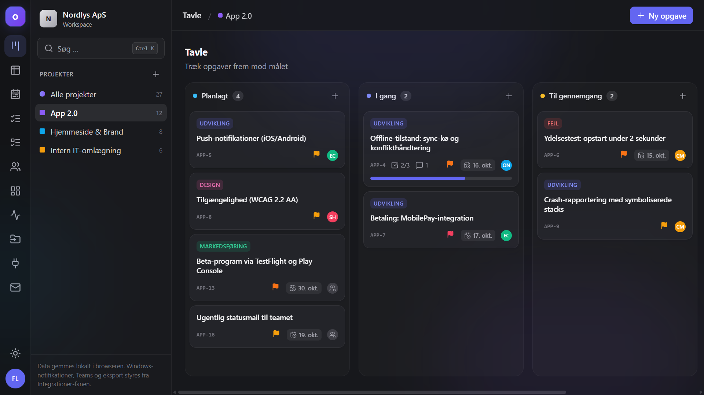
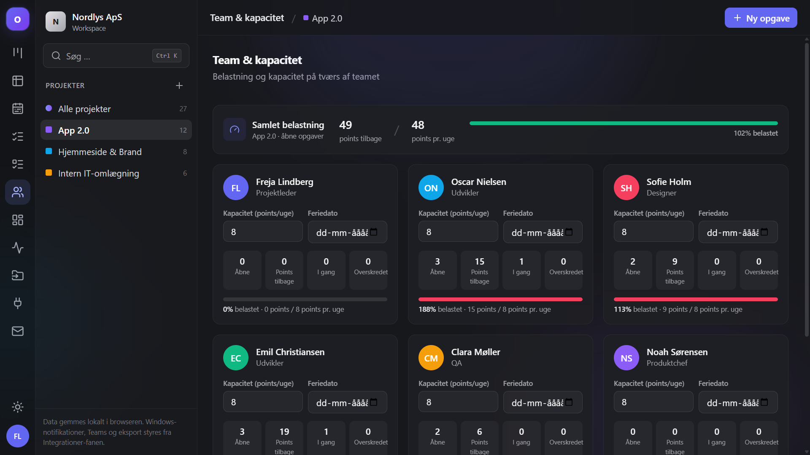
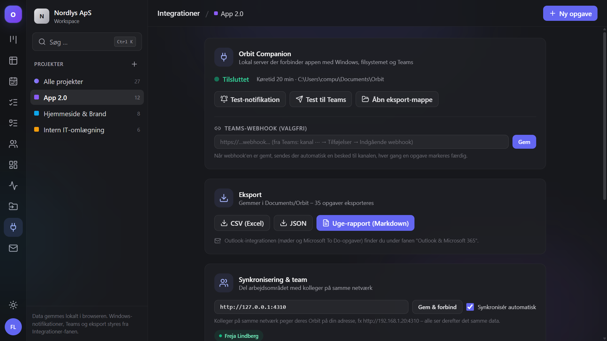
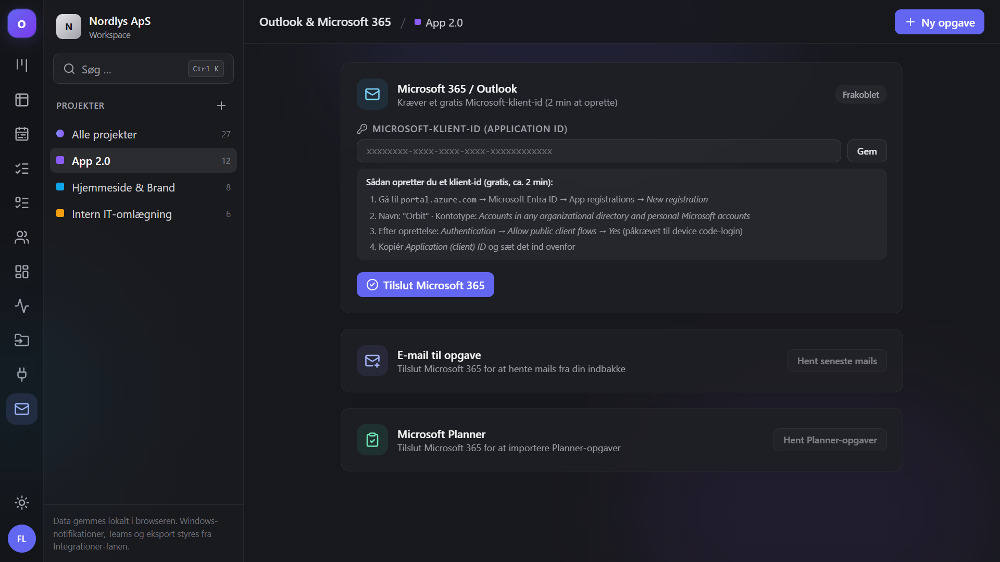
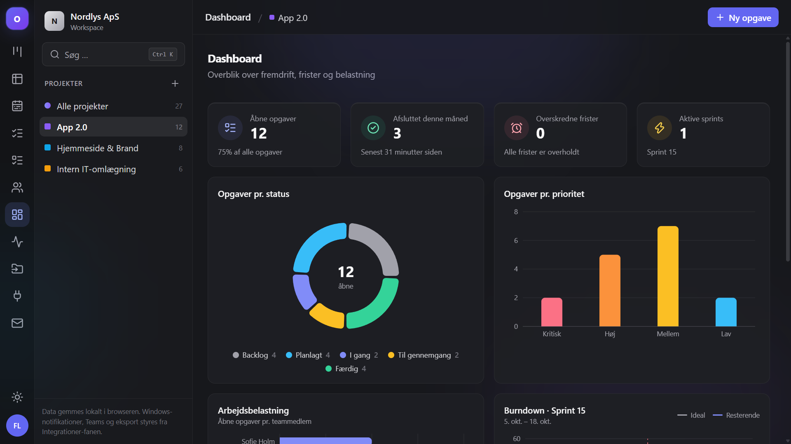
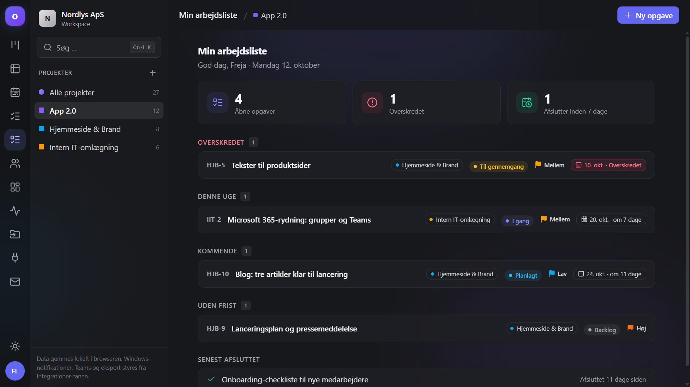
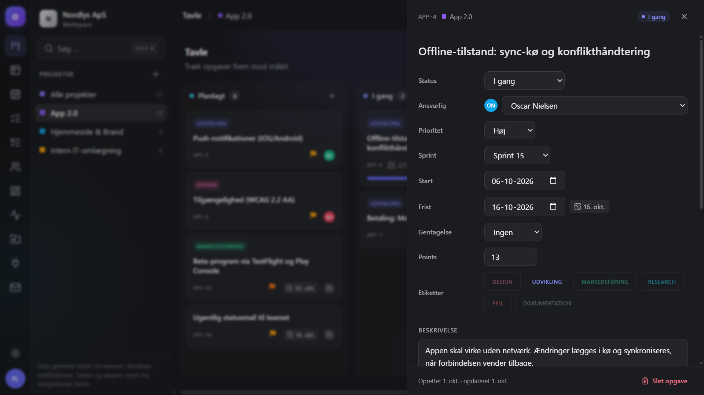

# Orbit – Projektstyring

Et moderne, dansksproget projektstyringsværktøj til Windows – inspireret af Monday, Microsoft Teams og Azure DevOps, med direkte integration til operativsystemet, Teams, Microsoft 365 og AI. Orbit kører lokalt. Tilsluttede AI-tjenester kræver deres egne konti og eventuelle abonnementer.



## AI-udførelse og Realmread-pilot

Chatten kan knytte en arbejdsordre til en isoleret Git-gren, vise agenternes faktiske arbejde og gemme commit, leverance og kontrolresultater. Plan-godkendelse, dependencyfejl, genoptagelse og backup er gjort eksplicitte. PDF/DOCX, billeder, versioneret projektbibel, WIP-grænser og afgrænset versionsscope understøtter arbejdet.

Læs [opsætning, betalingsregler, datagrænser og verifikation](docs/orbit-autonomy.md), [Realmreads første pilotforløb](docs/realmread-onboarding.md) og [det prioriterede restarbejde](docs/orbit-next.md). Krav: Node.js 22.13+ (24 LTS anbefales), Git og `npm ci`. Flere dages autonomi og alle leverandørkonti er endnu ikke verificeret i et rigtigt projekt.

## Funktioner

### Planlægning

- **Tavle** – Kanban med træk-og-slip, inline oprettelse og klikbar prioritet på kortene
- **Tabel** – sorterbar og filtrerbar oversigt med gruppeéringer
- **Tidslinje** – Gantt-lignende planlægning med sprint-bånd og "i dag"-markør
- **Backlog & Sprints** – træk opgaver mellem sprints, start/afslut sprints, points
- **Team & kapacitet** – belastning vs. kapacitet pr. medlem, ferie, "hvem har plads?"
- **Min arbejdsliste** – personligt overblik med forsinkelser og ugens frister
- **Dashboard** – status, prioritet, burndown og arbejdsbelastning
- **Tilbagevendende opgaver** – daglige/ugentlige/månedlige opgaver opretter selv næste instans
- **Kommandopalette** – `Ctrl+K`: søg, opret og naviger uden mus

### Samarbejde & data

- **Teamsync** – del arbejdsområdet med kolleger på samme netværk (WebSocket, tilstedeværelse)
- **Projektskabeloner** – opret fx et helt hjemmesideprojekt med 10 opgaver på ét klik
- **Import** – Trello JSON, Monday CSV og Jira CSV (se `docs/samples/`), Microsoft Planner via Graph
- **Eksport** – CSV, JSON og uge-rapport (Markdown) til `Documents/Orbit`
- **Aktivitet** – levende feed over alt der sker

### Integrationer (Orbit Companion)

- **Windows-notifikationer** – toast ved afsluttede opgaver og morgen-overblik
- **Teams-webhooks** – besked til kanal ved afsluttede opgaver + automatisk uge-rapport
- **Microsoft 365 / Outlook** – officielt device-code-login: hent To Do-opgaver, se møder, lav opgaver direkte fra mails
- **AI-assistent** – foreslå underopgaver, opsummér kommentarer og foreslå din næste opgave (OpenAI-kompatibel, nøglen gemmes kun lokalt)
- **Morgen-påmindelser** + **automatisk uge-rapport** på valgte tidspunkter
- **Synkronisering & team** – del arbejdsområdet på netværket, eller kør `server/sync-server.mjs` på din egen server med token-auth og sync over internettet
- **Kunde-statusside** – read-only delingslink pr. projekt med live status (`/public/status/<token>`)
- **Backup** – daglig automatisk sikkerhedskopi med ét klik gendannelse
- **Automatisering** – Teams-besked ved afsluttede opgaver, notifikation til ansvarlig, auto-tildeling ved kritisk prioritet
- **Papirkurv** – slettede opgaver kan gendannes i 30 dage

### Samarbejde & struktur

- **I dag-visning** – intelligent kø: "Fortsæt", "Skynd dig" og AI-forslag til næste opgave
- **Tidsregistrering** – start/stop-timer på opgaver med dagssum
- **Afhængigheder** – "blokeret af"-relationer, auto-forskydning og kritisk sti på tidslinjen
- **Tilpasselige felter** – egne felter pr. projekt (tekst/tal/valgliste) som kolonner i tabellen
- **Gemte visninger** – filtre du kan genbruge og dele
- **Bulk-handling** – markér mange opgaver og tildel/flyt/slet på én gang
- **Duplikér & flyt** – opgaver kan kopieres eller flyttes mellem projekter
- **Arkiv** – afsluttede projekter gemmes væk og kan gendannes
- **Notifikationscenter** – @mentions og hændelser med udlæst/ulæst
- **Kommentar-tråde** – svar, redigering og 👍🎉❤️-reaktioner
- **Vedhæftninger** – filer direkte på opgaven (gemmes lokalt via companion)
- **Dansk/engelsk** – hele appen skifter sprog (DA/EN-knap i topbjælken)

### Analyse

- **Projekt-puls** – health-score pr. projekt med forklaringer og AI-risikovurdering
- **Velocity** – planlagt vs. gennemført pr. sprint + estimat vs. faktisk tid

### Platform & udviklere

- **Åbent API + webhooks** – `GET /api/v1/*` og `task.completed`-events (se docs/api.md – inkl. Power Automate-eksempel)
- **Azure DevOps** – to-vejs sync af work items (PAT) – afslut i Orbit, status skrives tilbage
- **Asynkron standup** – dagens status postes til Teams
- **Onboarding-tur** ved første start + **?** viser alle genveje
- **PWA** (offline app-skal) + **Tauri-desktopskal** (Companion køres separat; se `docs/desktop.md`)

| Team & kapacitet | Integrationer | Outlook & Microsoft 365 |
|---|---|---|
|  |  |  |

| Dashboard | Min arbejdsliste | Opgavedetalje |
|---|---|---|
|  |  |  |

## Kom i gang

```bash
npm install
npm run dev        # app (5173) + companion-server (4310)
```

Andre kommandoer:

```bash
npm run companion      # kun companion-serveren
npm run build          # produktionsbuild
npm run test:smoke     # automatiseret test af alle companion-endpoints
npm run tauri build    # Windows-desktopapp (MSI/EXE) – se docs/desktop.md
```

## Platforme

- **Web/PWA** – installerbar i Chrome/Edge, virker offline (service worker)
- **Desktop** – Tauri-app med MSI/NSIS-installer (`src-tauri/`, se docs/desktop.md)
- **Windows-genveje** – `scripts/Start-Orbit.bat` + autostart (Install-Autostart.bat)

## Opsætning

- **Teams-beskeder**: kanal → ⋯ → Tilføjelser → Indgående webhook → indsæt URL under Integrationer.
- **Microsoft 365**: opret gratis app-registrering (2 min – guide i appen under Outlook-fanen), indsæt klient-id, tilslut med din konto.
- **AI**: tilslut tjenester i Orbit-chatten. Eksternt forbrug kræver bekræftet inkluderet abonnementsadgang uden ekstraforbrug; et API-token eller chatabonnement alene er ikke dokumentation for dette.

## Teknologi

React 19 · TypeScript · Vite · Tailwind CSS · Zustand · dnd-kit · Recharts · Express · WebSocket · MSAL · Microsoft Graph · Tauri · date-fns · lucide-react

## Roadmap

- [ ] To-vejs-sync med Microsoft To Do
- [ ] PDF-eksport og rapportdesigner
- [ ] Kommentar-redigering og svar-tråde
- [x] Oversættelse af alle views til engelsk
- [ ] Mobilapp (PWA er installerbar i dag)
