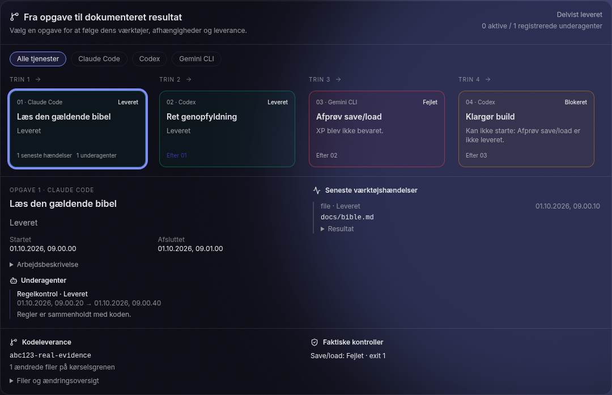

# Orbit: pålidelig projektudførelse

Denne ændring samler projektets arbejdsordre, AI-kørsel, isoleret Git-gren og dokumentation i chatten. `done` på en kørsel betyder leveret til gennemgang. En almindelig opgave bliver ikke automatisk godkendt som færdig.

## Kom i gang

1. Brug Node.js 22.13 eller nyere (24 LTS anbefales), Git og `npm ci`.
2. Start Companion og app med `npm run dev`. Windows: `scripts/Start-Orbit.bat`.
3. Åbn Orbit-chatten og tilslut dine lokale coding-værktøjer. Login foretages med leverandørens eget værktøj.
4. Bekræft kun inkluderet abonnementsforbrug, når du har kontrolleret kontoen og deaktiveret ekstraforbrug hos leverandøren. Et almindeligt chatabonnement dokumenterer ikke i sig selv API-adgang.
5. Opret/vælg projektet og en chat. Tilknyt en ren, lokal Git-mappe under **Repository og kvalitetskontroller**. Gem egne ændringer først.
6. Upload bibel, dokumenter eller screenshots. Tekst fra PDF/DOCX kan bruges som bibelkladde. Vælg **Gør kladden gældende** for at fastlægge en version.
7. Vælg en arbejdsordre og kør Auto. Orbit viser jobs, afhængigheder, underagenter, værktøjshændelser, commit og faktiske testresultater.

Direkte chat med én tjeneste er til læsning/rådgivning. Repositoryændringer køres gennem Auto, så arbejdet har en isoleret arbejdsgren og en gemt leverance. Codex, Claude, Gemini og Qwen Code bruger native læsetilstand i analysefaser; Kimi bruger en eksplicit profil med læse-/søgeværktøjer. Brugerdefinerede CLI-skabeloner og andre værktøjers egne tilladelser skal også være korrekt konfigureret.

## Hvad kørselsmotoren garanterer i den implementerede sti

- Planer valideres for dublerede id'er, ugyldige afhængigheder, ukendte faser og cykler før udførelse. Danske og engelske fasenavne normaliseres ens, også ved kontrol af repository-adgang.
- Planredigering bevarer læsetilstand og kontekstfiler. Sletning forskyder afhængigheder korrekt og afvises, hvis andre jobs stadig afhænger af det slettede job. Afhængigheder kan redigeres, og en afvist godkendelse viser serverens forklaring i dialogen. Tomme jobs bortfiltreres ikke lydløst. Planvinduet kan lukkes med Escape eller **Se arbejdskortet** uden godkendelse/aflysning; kladden bevares, mens du undersøger kortet. **Redigér og godkend planen** åbner den igen.
- Afhængige jobs starter kun efter vellykkede forgængere. Fejl kan give `partial`, `blocked` eller `error`; de bliver ikke skjult som succes.
- En plan, der afventer godkendelse, starter aldrig på grund af timeout.
- Lukning af fanen aflyser ikke Auto. **Stop** sender en særskilt afbrydelse til serveren og den lokale proces.
- Companion opdaterer arbejdsordrens status og leverancebevis, selv når browseren er lukket. Projektets gemte scope, afhængigheder, WIP-grænse, repository, kontroller og gældende bibel bruges som grundlag.
- Præciseringer og nye vedhæftninger kan sendes fra den samme chat under arbejdet. De gemmes og gælder fra næste job; en allerede startet agent får ikke efterfølgende instruktioner ind i sin oprindelige prompt.
- Status og strukturelle hændelser gemmes på disk, med heartbeat hvert tiende sekund. En afbrudt Companion-kørsel markeres som afbrudt ved næste opstart.
- Genoptagelse bevarer bibel, instruktioner, tidligere resultater, dependencygraf og arbejdsmappe. Der startes ikke et nyt tomt projekt. Genoptagelse er eksplicit, fordi en ekstern handling kan være sket før nedbruddet.
- Hver repository-kørsel bruger `orbit/<run-id>` i en separat Git-worktree. Den oprindelige mappe bliver ikke ændret af Orbits Git-operationer.
- Der er én skrivende jobkæde ad gangen. Flere kodere skriver ikke parallelt i samme checkout.
- Fejlede kodeforsøg bevares på `orbit-attempt/<run-id>/<job-id>`, før arbejdsgrenen føres tilbage. Uafhængigt arbejde arver derfor ikke fejlens kodeændringer.
- Konfigurerede kontroller udføres som faktiske programmer med argumentlister, uden shell-fortolkning. Hver kontrol gemmes ved start og afslutning med proces-id, exitkode og output. Stop/timeout afslutter procestræet; genstart bevarer afsluttede resultater og markerer en igangværende kontrol som afbrudt. Genoptagelse kan gentage kontrollerne uden at gentage færdige kodejobs. Fejlede kontroller blokerer den samlede leverance.
- Hvis en kontrol ændrer versionsstyrede filer, kan den ikke godkende det allerede gemte commit. Det vises som en fejl.
- Med afgrænsede rettelsesforsøg aktiveret kan en faktisk fejlet kontrol udløse ét ekstra coding-job inden for den oprindelige arbejdsordre. De samme kontrolkommandoer køres igen; begge gennemløb gemmes med commit og output. Manglende programmer, ændringer fra selve kontrollen og fortsatte fejl blokerer leverancen. Genoptagelse nulstiller ikke reparationsgrænsen.
- Krævet modelreview udføres af en anden tilgængelig coding-tjeneste på et konkret Git-commit. Standarden er mindst 8/10; critical/major-fund blokerer uanset score. Kode-review skal angive undersøgte filer, og en reviewer, der ændrer arbejdsområdet, afvises. Manglende reviewer blokerer, hvis kravet er slået til. Aktiviteter og processer fra reviewer spores sammen med jobbet.
- En models kvalitetsscore er et review-signal. Den erstatter ikke tests, build eller spiltest.

Grænser: højst 100 jobs i en plan, én CLI-proces højst 60 minutter, hver konfigureret kontrol højst 10 minutter og højst 20 MB stdout pr. CLI-job. Store opgaver skal opdeles. Der er ikke implementeret en generel døgnkørende multiworker-platform, automatisk kvotefornyelse eller automatisk merge/deploy.

## Gennemgang af kodeleverancer

**Gennemse kodeændringer** findes i chat, arbejdskort og opgavens AI-leverance. Visningen sammenligner kørslens base med et bestemt registreret commit, fil for fil, og tilbyder en samlet Git-patch. Senere lokale ændringer eller et nyt rettelsesforsøg ændrer ikke den valgte sammenligning. Binære filer markeres særskilt; store tekstændringer vises som tydeligt markerede udsnit. Patch-download er begrænset til 16 MB og kræver den bevarede arbejdsmappe. Orbit anvender ikke patchen og merger ikke ændringer automatisk.

## Sammenhængende arbejde på tværs af arbejdsordrer

Under **Repository og kvalitetskontroller** kan du vælge **Fortsæt på projektets verificerede AI-arbejdsgren**. Valget kræver et repository og mindst én faktisk kontrol. Når en arbejdsordre leverer med beståede kontroller og opfylder de valgte reviewkrav, gemmer Companion dens commit som næste udgangspunkt. Næste kørsel får fortsat sin egen worktree, nu fra den verificerede kode. Oprindeligt checkout forbliver urørt.

En afhængig opgave må i denne tilstand fortsætte fra en forgænger, der er til gennemgang, har beståede kontroller og indgår i den samme gemte arbejdsgren. Det godkender ikke forgængeren som færdig. WIP-grænser gælder fortsat; en fyldt review-kolonne kan derfor bremse forløbet. Uden dette projektvalg kræver afhængigheder fortsat status Færdig.

Fejlede eller utestede leverancer flytter ikke projektets udgangspunkt. Browseropdateringer kan ikke overskrive den serverstyrede pegepind med en gammel version. Hvis kildegrenen og AI-grenen divergerer, stopper næste kørsel før agentstart; integration foretages i Git. Hvis kildegrenen allerede indeholder AI-arbejdet, bruges den nyere kilde som grundlag. En gammel afbrudt kørsel kan ikke genoptages oven på en projektgren, der siden er gået videre.

**Gennemse hele AI-arbejdsgrenen** sammenligner alle endnu ikke integrerede ændringer med kildens commit ved seneste kørselsstart. Den almindelige gennemgang på en arbejdsordre viser kun den pågældende kørsels ændringer. Hver sammenligning og patch er bundet til et registreret commit. Den samlede gren er klar til din gennemgang og efterfølgende Git-integration; Orbit merger eller publicerer den ikke automatisk.

## Tidligere AI-værksted

AI-værkstedets separate startknap er erstattet af en gennemgået overførsel til almindelige arbejdsordrer. Vælg ét projekt og de ønskede jobs. Beskrivelser, spørgsmål/svar, historiske resultater og afhængigheder bevares; manglende eller cirkulære forgængere blokerer overførslen. Gentagelse skaber ikke dubletter. Alle nye arbejdsordrer begynder i backlog, også når et gammelt job var markeret færdigt. Versionens scope ændres ikke. De oprindelige jobs bevares, og overførte kort åbner arbejdsordren med dens aktuelle status.

## Tjenester og betaling

Alle eksterne transports kræver `billingMode: included` og `noExtraCharges: true`. Ukendt og særskilt forbrugsbetaling afvises. Den tidligere `allowPaidApis`-genvej giver ikke længere adgang, heller ikke i den ældre opgaveassistent.

Ollama regnes kun som lokal ved en loopback-adresse og en model uden kendt cloudmarkering. Eksterne endpoints, cloudnavne og modeller med `remote_host` kræver samme abonnementsbekræftelse. Dette er ikke en aflæsning af leverandørens faktura eller en kontrol af en vilkårlig lokal proxy.

| Forbindelse | Implementeret transport | Begrænsning |
|---|---|---|
| Codex / ChatGPT | Lokal Codex CLI | Eget login og faktisk abonnement skal fungere; dette er ikke en kopi af alle ChatGPT-funktioner. |
| Claude | Lokal Claude Code CLI | Native værktøjer/MCP og Agent-hændelser. |
| Gemini | Lokal Gemini CLI | Installeret, konfigureret CLI kræves. |
| Kimi | Lokal Kimi CLI | Installeret, konfigureret CLI kræves. |
| Qwen Code | Lokal Qwen Code CLI | Repositoryværktøjer og native MCP; egen konto og betaling skal valideres. |
| Qwen lokal | Lokal Ollama | Tekstgenerering; ingen generel fil-/kommando-værktøjsløkke. |
| Grok | Konfigurerbar CLI / særskilt xAI API-adapter | Katalogposten er ikke dokumentation for en officiel abonnementsdækket CLI. Skal valideres konkret; API er ikke automatisk inkluderet i Grok-abonnementet. |
| Meshy | API-job med gemt provider-id og GLB | Inkluderede API-credits og stop for ekstraforbrug skal kontrolleres på kontoen. |
| HeyGen | API-job med avatar-/stemme-id og lokal MP4 | Kontoens API-adgang og credits skal kontrolleres. |
| ElevenLabs | API-lydproduktion | Kontoens inkluderede credits og overage-indstillinger skal kontrolleres. |

Aktivitetsregnskab og fejlanalyse bruger de seneste 60 kørsler og oplyser udsnittets størrelse. Tider beregnes kun fra registreret start og afslutning; ventende/blokerede jobs indgår ikke som udførte forsøg i fejlprocenten. Antal hovedjobs er hverken antal provider-kald, tokens eller fakturering.

Orbit måler ikke leverandørernes faktiske resterende kvoter. UI viser brugerens bekræftelse og aktivitetsantal, aldrig et opdigtet beløb på 0 kr. Arvede standardmiljøvariable til forbrugsbetalte model-API'er fjernes ved start af CLI-processer; native CLI-konfiguration kan stadig påvirke konto/betaling og skal kontrolleres hos leverandøren.

Meshy/HeyGen gemmer hensigt og jobkvittering. Efter genoptagelse bruges det eksisterende job-id. Hvis forbindelsen forsvandt før kvitteringen, stopper Orbit med en forklaring frem for at indsende samme produktion igen. En afbrudt lokal kørsel annullerer ikke nødvendigvis et allerede accepteret job hos leverandøren.

## MCP og livevisning

De fem native coding-adaptere bevarer deres egen MCP-konfiguration ved udførelse. Kimis analyseprofil begrænser værktøjer til læsning og søgning. Codex JSONL samt Claude, Gemini, Kimi og Qwen Code stream-json oversættes til offentlige værktøjs- og agenthændelser i Orbit Live. [Adapterkontrakter og installation](ai-adapters.md) beskriver flag og begrænsninger. Ukendte eventtyper ignoreres; eventformater fra andre CLI-versioner skal afprøves.

Strukturelle hændelser gemmes i en append-only journal; den aktuelle kørsel holder højst 400 hændelser i sin statusfil. Heartbeat har en separat lille fil, og hyppige værktøjshændelser udløser højst én fuld statusoverskrivning pr. sekund. Vigtige kontrolpunkter gemmes straks. Live-polling sender korte, markerede leveranceuddrag og dokumentidentiteter frem for hele bibler. Hele leverancer kan stadig eksporteres. Journalen kan downloades som aktivitetslog; over 8 MB eller ved en ufuldstændig log deaktiveres browser-genafspilning i stedet for at vise et misvisende udsnit. Logtekster er uddrag, mens den fulde leverance gemmes separat.

Historikken kan søges efter det viste mål eller kørsels-id og filtreres pr. projekt med sideskift til ældre kørsler. Listen bruger små, afledte indeksfiler; den fulde bibel og leverance hentes først, når en kørsel åbnes. Ældre kørsler får automatisk et indeks, og forældede indeks genopbygges fra den oprindelige fil. Ulæselige historikfiler oplyses og bevares.

Arbejdskortet grupperer opgaver efter deres afhængigheder. En valgt opgave viser registrerede værktøjshændelser, underagenter, ventebegrundelse og leverance; tjenester kan fremhæves på tværs af forløbet. Kodecommit og faktisk udførte kontroller står særskilt. Heartbeat dokumenterer en svarende kørselsmotor, ikke model-fremdrift. Historik bevarer registrerede tidspunkter, og genafspilning viser først evidens ved den relevante hændelse. Den tidligere konstellation kan stadig vælges.



Billedet er taget i den rigtige brugerflade med en kontrolleret testfixture. Opgaver, modelnavne, underagent, commit og testresultat i billedet er demonstrationsdata; de beskriver ikke en gennemført Realmread-opgave.

Der er endnu ikke en fælles MCP-servermanager eller en universal tool-calling-loop for alle modeller. Livekortet viser de strukturerede hændelser, adapteren modtager. Det opfinder ikke underagenter, og det viser ikke modellernes interne ræsonnementer.

## Vedvarende arbejdskø

En åben arbejdsordre kan lægges i AI-kø fra opgavens detaljevisning. Køen gemmes atomisk og udfører én kørsel ad gangen. Den kontrollerer projektets aktuelle scope, afhængigheder, WIP, bibel, repository og kontrolkommandoer ved start. Et gentaget klik opretter ikke samme ventende arbejdsordre igen.

Planlagte triggere kan tilknyttes et projekt. En optaget motor lægger nye intentioner i kø; samme cron-minut deduplikeres også efter genstart. Cron bruger maskinens lokale tidszone og understøtter fem felter med tal, `*` og `*/n`. Tidspunkter, hvor Companion var lukket, efterkøres ikke.

Fejl, delvise resultater og usikre afbrydelser pauser køen. En gemt påbegyndt handling afspilles aldrig automatisk igen efter genstart. Et afsluttet resultat kan derimod afstemmes fra den gemte kørsel. En mulig overlevende agentproces blokerer fortsættelse, nye Auto-kørsler og opdatering — også efter endnu en genstart. Orbit Live viser proces-id og den afbrudte kørsel. På Linux kontrolleres også procesgruppen, mens afsluttede zombieprocesser ikke blokerer. Ukendte processer afsluttes ikke automatisk efter et nedbrud. Kontrollen **Pause efter denne kørsel** lader den aktive opgave afslutte. Køen har højst 100 ventende/aktive intentioner og bevarer de seneste 200 afsluttede poster.

Normal nedlukning stopper både Auto, kontrolkommandoer og lokale processer fra direkte AI-chat. Nye ændringer afvises, mens Companion lukker. Windows-opdatering afvises, hvis en kørsel eller samtale stadig arbejder. Procesregisteret for direkte chat er kun i hukommelsen; et hårdt maskinnedbrud kræver fortsat kontrol af eventuelle efterladte processer.

Backup omfatter køfilen, og gendannelse genindlæser den på pause. Windows-stop pauser også køen før processtop. Maskinen og Companion skal fortsat være tændt; dette er én lokal worker, ikke en distribueret cloudtjeneste.

## Bibel, billeder og beslutninger

- Hver projektkørsel gemmer identiteten på bibelversion, arbejdsordre og projektets beslutningsnoter med SHA-256, versionsmål og scope. Beslutningsnoter medsendes i fuld længde; øvrige notetyper bliver ikke automatisk til krav. Genoptagelse bevarer dette grundlag.
- Jobkontekstfiler læses kun fra kørselsmappen, inklusive kontrol af symlinks. Hele UTF-8-filer medsendes inden for dokumenterede grænser (20 filer, 1 MB pr. fil, 4 MB i alt); manglende, binære og større filer forklares eksplicit til agenten og vises på arbejdskortet.
- Den komplette bibel gemmes med kørslen. Tidligere hårde afskæringer på 6.000 tegn er fjernet fra kørselskonteksten.
- Kørsels- og tjenestehukommelse er adskilt pr. projekt. Ældre global hukommelse importeres ikke automatisk til et projekt.
- Lange CLI-instruktioner gemmes i en kontekstfil, som agenten instrueres i at læse, så Windows' argumentgrænse ikke skærer teksten af.
- Bibelkladde og gældende version er adskilt. De seneste 30 publicerede versioner bevares.
- PDF udtrækkes med sidehenvisninger; DOCX udtrækkes som tekst. Billedbaserede PDF'er kræver OCR, som endnu ikke er implementeret.
- Billeder kan åbnes i en tastaturbetjent visning med originalstørrelse. Tekst, vedhæftningsreferencer og planudkast holdes pr. samtale og bevares i fanens session ved genindlæsning; billedbytes kopieres ikke til browserens kladdelager. Genindlæste dokumenter kan igen bruges som bibelkladde. Uploads serialiseres, og over 10 filer afvises tydeligt frem for at blive skåret fra.
- Codex modtager native billedargumenter; lokal Qwen/Ollama modtager base64-billeddata efter kontrol af modellens vision-kapabilitet. Modelprofilens cloudmarkeringer kontrolleres også, så et omdøbt cloudnavn ikke alene omgår betalingskontrollen.
- Vedhæftninger gemmes på serveren og rehydreres ved senere ture. Browserens vilkårlige lokale filstier accepteres ikke som uploadreferencer.
- Markdown vises med lister, tabeller og kodeblokke. Modeloutput får ikke lov at indsætte rå HTML. Store jobresultater vises som tydeligt markerede uddrag med link til fuld eksport.

## Data og gendannelse

Companion gemmer seneste workspace i `~/.orbit/workspace.json` med atomisk filudskiftning. Også chat, bibler, noter og øvrige vedvarende store-felter udløser synkronisering. Ekstra samlinger har særskilte ændringstider, så en gammel fane ikke overskriver en nyere bibel med en ældre kopi. Dette er stadig ikke et transaktionelt flerbruger-dokumentredigeringssystem: samtidige ændringer i samme ekstra samling bruger seneste ændringstid.

Opgaver, projekter og sprints flettes pr. id og ændringstid. Sletninger har særskilte tidsstempler, så en gammel fane hverken fjerner nye serveropgaver eller genopretter allerede slettede opgaver. En nyere gendannelse kan genoprette elementet. Ældre klienter uden sletningsmetadata kan fortsat tilføje og opdatere, men skal opgraderes for at synkronisere sletninger.

Backupformat v2 inkluderer workspace, AI-historik, leverancedokumenter, hukommelse, uploads, producerede medier og almindelige vedhæftninger. Filer har SHA-256-kontrol. Alle stier og hashes valideres før filgendannelse, som stages og rulles tilbage ved fejl under mappeudskiftningen eller den afsluttende skrivning af workspace. Køens pause gemmes før workspace-commit, så gamle køopgaver ikke starter ved genstart efter gendannelsen. Gendannelse er en erstatning, ikke almindelig tidsstempel-fletning. Den aktuelle servertilstand sikkerhedskopieres først. Hver vellykket gendannelse får en ny version, som alle åbne faner skal hente; ældre versioner afvises ved synkronisering. Fanerne erstatter deres data frem for at flette nyere lokale ændringer tilbage. Browserdata fra før skiftet kan hentes fra backupafsnittet i den pågældende fane; kopien ligger i sessionlager eller, ved pladsmangel, kun i hukommelsen. Ældre appversioner skal opdateres efter en gendannelse. Dette er ikke en fuld transaktionsjournal mod strømsvigt midt under mappeudskiftningen.

Backup **udelader** credentials, native OAuth-caches, Companion-konfiguration (herunder integrationsopsætning, promptbibliotek og triggere), eksterne repositories og Git-worktrees. Worktrees på samme maskine bevares ved gendannelse. Flytning til en anden maskine kræver separat Git-backup og ny tilslutning af konti. En historisk kørsel uden sin oprindelige mappe kan læses, men ikke genoptages. Backup har en grænse på 256 MB; store mediebiblioteker kræver separat filbackup. Den er ikke en automatisk komplet maskinbackup.

AI-kontrol, backup og Companion-konfiguration kræver lokal adgang fra en lokal Orbit-origin. Remote AI-webhooks er derfor ikke åbne fra internettet. Netværksdeling af andre projektfunktioner findes fortsat, men er ikke en erstatning for en komplet sikkerhedsrevision af alle legacy-integrationer.

## Kontrol før brug til rigtigt projekt

```sh
npm ci
npm run build
npm run lint
npm run test:imports
npm run test:workspace
npm run test:ai
```

AI-tests bruger lokale falske agenter og mockede mediesvar. En procesprøve tvangslukker en rigtig Companion midt i et job, genstarter den to gange, kontrollerer blokeringen mod en overlevende agent og genoptager efter agentstop uden at gentage færdigt arbejde. De afprøver faktisk Git, filændringer, subprocesser, HTTP, genstart, backup og kontrolkommandoer uden betalte kald. De dokumenterer ikke kvaliteten af en rigtig model eller gyldigheden af dit abonnement.

En særskilt varighedstest holder godkendelsespausen åben og kontrollerer heartbeat, ingen jobstart og bevaret bibel, før den sender en eksplicit godkendelse:

```sh
ORBIT_SOAK_MINUTES=12 node scripts/soak-ai.mjs
```

På Windows sættes miljøvariablen med PowerShell: `$env:ORBIT_SOAK_MINUTES='12'`. CI kører build og tests på Linux og Windows. Native provider-login, Windows-launcherens faktiske proceshåndtering, Godot og Realmread kræver afprøvning på den rigtige installation.

## Næste arkitekturtrin

1. Verificér en rigtig Realmread-opgave fra arbejdsordre til build og manuel spiltest.
2. Indfør et vedvarende joblager med leases, idempotens og kontrolleret recovery, før flere workers eller maskiner tilføjes.
3. Verificér adapterkatalogets kapabiliteter mod de installerede versioner og konti: filadgang, tests, billeder, browser, MCP, 3D, lyd og video.
4. Tilføj versionsbaseret dokumentsøgning med kildehenvisninger og kontekstbudget; bevar hele biblen som autoritativ kilde.
5. Tilføj leverandørspecifik kvote-/reset-aflæsning, hvor der findes understøttede interfaces. Ukendt må fortsat være ukendt.
6. Udvid først parallel kodning med separat worktree pr. job og en integration-/testkø. Flere samtidige svar er ikke det samme som verificeret fremdrift.
7. Byg fælles MCP-konfiguration og værktøjstilladelser samt bedre mediepreview, samtaleforgrening og stemmeinput. Funktionerne findes ikke fuldt ud i denne ændring.

## Verifikation udført under udviklingen

30. oktober 2026: følgende kontroller bestod på Linux. GitHub Actions kører desuden build, lint og server-/datakontroller på Windows; tre operativsystemspecifikke prøver springes over dér. Windows-kontrollen er ikke en afprøvning af brugerens installerede desktopapp.

| Kontrol | Resultat |
|---|---|
| Produktionsbuild | Bestået |
| Lint | Ingen fejl; React-advarsler består |
| Importkontroller | 21 bestået |
| Workspace-tests | 4 bestået |
| Server-/AI-tests | 87 bestået |
| Chromium-forløb | 17 bestået |
| Fem native CLI-distributioner | Version og alle anvendte flag fundet i hjælpen; ingen modelkald |

Browserforløbene dækker:

- Bibel på over 6.000 tegn, publiceret version, repositorytilknytning, faktisk filkontrol, commit og status til gennemgang efter genindlæsning.
- Fejlede kørsler, der forbliver fejlede, samt én afgrænset rettelse efter en faktisk testfejl med begge testresultater bevaret.
- Præcisering og upload efter genindlæsning; fortsat udførelse og afslutning med browseren lukket.
- Vedvarende kø og afhængige arbejdsordrer, hvor næste opgave faktisk læser forgængerens verificerede kode. Kildens checkout bevares.
- Projektoprettelse på mobil, gennemgang af et eksisterende projekt og import af plan uden dubletter.
- Overførsel fra det tidligere AI-værksted, bevarede afhængigheder og korrekt opgavekobling ved øjeblikkelig afsendelse.
- Billedvisning, tastaturbetjening, samtaleadskilte kladder og vedhæftninger efter genindlæsning.
- Arbejdskort, værktøjshistorik, underagenter, mobilbredde, søgning/sideskift i historikken og synlige processer fra afbrudte kørsler.
- Planredigering med bevaret læsetilstand, kontekst og afhængigheder; cirkulære planer afvises, og en udskudt godkendelse bevarer kladden.
- Sletning og backupgendannelse på tværs af to åbne faner, afvisning af forældede data og adgang til fanens kopi fra før gendannelsen.

Kodegennemgang og patch-download er kontrolleret med reelle Git-ændringer, også i mobilbredde. Serverprøverne fremprovokerer desuden skrivefejl under gendannelse og et rigtigt Companion-nedbrud under arbejde med to efterfølgende genstarter.

Varighedsprøver bruger lokale prøveagenter, faktiske ventetider og rigtige filer. De er **ikke** dokumentation for modelkvalitet, abonnementer eller flere døgns autonomi. De nyere rapporter identificerer de indlæste moduler med SHA-256. Den første tretimersprøve registrerede endnu ikke modulhashes. Prøverne startede under udviklingen og omfatter derfor forskellige kodeversioner. Senere rettelser dækkes af de almindelige kontroller, ikke automatisk af en allerede kørende varighedsprøve.

- [180 minutters godkendelsespause](verification/approval-180-minutes-2026-10-30.json): 2.159 stikprøver uden automatisk start; gennemført efter eksplicit godkendelse. Ældre checkpoint uden modulhashes.
- [90 minutters godkendelsespause](verification/approval-90-minutes-2026-10-30.json): 1.080 stikprøver, ingen jobstart før eksplicit godkendelse, derefter gennemført.
- [60 minutters aktiv udførelse med seks jobs](verification/execution-60-minutes-six-jobs-2026-10-30.json): stop efter tre, genoptagelse af samme worktree, ingen gentagelse af afsluttede jobs og bestået kontrol af alle seks filer.
- [Native CLI-kontrol](verification/native-cli-2026-10-30.json): Codex 0.166.0, Claude Code 2.1.314, Gemini CLI 0.66.0, Kimi Code 2.4.1 og Qwen Code 0.26.4.

Browserkontroller: `npx playwright install chromium` efterfulgt af `npm run test:browser`. De starter isolerede testservere på 5173/4310 og kræver ledige porte. Lokale testdata ligger i en separat midlertidig mappe.

En separat aktiv varighedsprøve kan køres uden provider-kald:

```sh
ORBIT_SOAK_JOB_SECONDS=600 ORBIT_SOAK_JOBS=6 node scripts/soak-ai-execution.mjs
```

Den udfører seks lokale prøvejobs, stopper efter den første halvdel, genoptager samme arbejdsgren uden at gentage færdige jobs og kontrollerer de faktiske filer. Rapporten indeholder kodehashes, varighed og testresultater. Den måler kørselsmotorens adfærd, ikke en rigtig models kvalitet.
